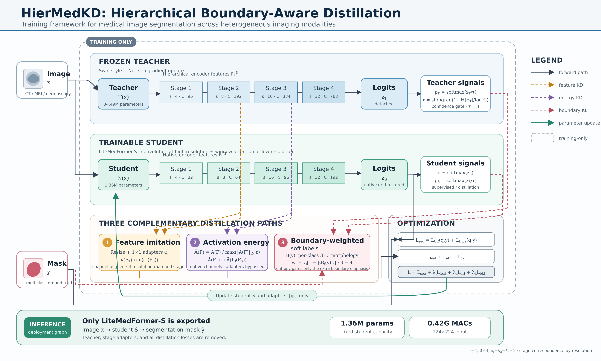

# HierMedKD: Hierarchical Boundary-Aware Distillation for Medical Image Segmentation Across Heterogeneous Imaging Modalities

Anonymous implementation accompanying a manuscript submitted to MMM 2027 for
double-blind review. This repository contains no author names, affiliations, or
personal contact details.

This repository provides:

- the PyTorch implementation of the teacher, compact student, stage adapters,
  and three complementary distillation objectives;
- manuscript-aligned configurations for Synapse/BTCV, ACDC, and ISIC 2018;
- training, evaluation, and lightweight consistency-check entry points; and
- aggregate results corresponding to the submitted manuscript.

**Quick navigation:** [Method](#method-overview) ·
[Scope](#artifact-scope) · [Setup](#environment) ·
[Datasets](#dataset-preparation) · [Training](#training) ·
[Evaluation](#evaluation) · [Results](#reported-results)

## Overview

HierMedKD transfers hierarchical representations and boundary knowledge from a
Swin-style U-Net teacher to a compact LiteMedFormer-S student. Its training-only
distillation objective combines:

- stage-aligned normalized feature imitation;
- channel-independent activation-energy transfer; and
- ground-truth boundary-weighted soft-label distillation with teacher-entropy gating.

The teacher and stage adapters are removed after training. The reported student
therefore retains the same 1.36M-parameter, 0.42G-MAC inference graph as the
scratch student.

## Method Overview



*HierMedKD training and inference architecture. A frozen Swin-style U-Net
teacher supervises LiteMedFormer-S through stage-aligned feature imitation,
channel-independent activation-energy transfer, and entropy-gated
boundary-weighted soft-label distillation. Only the 1.36M-parameter student is
retained for inference.*

The three paths are complementary. Feature imitation aligns hierarchical
representations after resolution-matched adaptation; activation-energy
transfer preserves spatial emphasis without forcing channel correspondence;
and boundary-weighted distillation focuses on difficult contours while the
teacher-entropy gate suppresses unreliable guidance. All distillation branches
are training-only and introduce no inference-time parameters or MACs.

## Artifact Scope

Included:

- teacher, student, adapter, and loss implementations;
- dataset loaders and manuscript-aligned configuration files;
- training and evaluation entry points;
- aggregate values transcribed from Tables 2-6 of the submitted manuscript.

Not included in this snapshot:

- restricted BTCV, ACDC, or ISIC images;
- trained teacher or student checkpoints;
- authoritative split manifests and their hashes;
- per-case scores, prediction hashes, native-grid predictions, or latency traces.

The values in `results/reported_results.yaml` are reported manuscript values,
not results generated automatically when this repository is installed. Exact
numerical reproduction requires the missing run artifacts above.

## Repository Structure

```text
.
|-- configs/                  # Base and dataset-specific YAML configurations
|-- data/                     # Tracked Python dataset-loader package
|-- figures/
|   `-- hiermedkd_architecture.png # Method architecture used in this README
|-- losses/                   # Supervised and distillation objectives
|-- models/                   # Teacher, student, and stage adapters
|-- results/
|   `-- reported_results.yaml # Aggregate values in the submitted manuscript
|-- tests/                    # Configuration and manuscript-value checks
|-- utils/                    # Metrics and checkpoint utilities
|-- config_loader.py          # Recursive _base_ configuration merging
|-- train.py                  # Distillation training entry point
|-- evaluate.py               # Student evaluation entry point
|-- requirements.txt
`-- LICENSE
```

Dataset files belong under `datasets/`, which is ignored by Git. The Python
loader package remains under `data/` and is tracked normally.

## Environment

- Python 3.8 or later
- PyTorch 1.12 or later
- CUDA 11.3 or later for GPU training

```bash
python -m venv .venv
source .venv/bin/activate
# Windows PowerShell: .venv\Scripts\Activate.ps1
python -m pip install --upgrade pip
pip install -r requirements.txt
```

### Quick Verification

The repository includes lightweight tests that require neither medical images
nor trained checkpoints:

```bash
python -m unittest discover -s tests -v
```

These checks validate configuration inheritance and confirm that the headline
and entropy-gate ablation values in `results/reported_results.yaml` match the
submitted manuscript. They are consistency checks, not substitutes for
training or evaluation experiments.

## Dataset Preparation

The datasets must be obtained from their official sources and used under their
respective terms. Restricted medical images are not redistributed.

### Synapse/BTCV

```text
datasets/synapse/
|-- train_vol/
|   |-- caseXXXX.nii.gz
|   `-- ...
`-- train_label/
    |-- caseXXXX.nii.gz
    `-- ...
```

The manuscript uses 30 released labeled cases with a 14/4/12
train/validation/local-test partition.

### ACDC

```text
datasets/acdc/training/
|-- patient001/
|   |-- patient001_frame01.nii.gz
|   |-- patient001_frame01_gt.nii.gz
|   `-- ...
`-- ...
```

The manuscript uses the 100 labeled training patients with a 70/10/20
patient-level partition. End-diastolic and end-systolic frames from one patient
must remain in the same partition.

### ISIC 2018 Task 1

```text
datasets/isic/
|-- ISIC2018_Task1-2_Training_Input/
|   |-- ISIC_0000000.jpg
|   `-- ...
`-- ISIC2018_Task1_Training_GroundTruth/
    |-- ISIC_0000000_segmentation.png
    `-- ...
```

The manuscript uses a seeded 1,815/259/520 image partition of the 2,594
released training pairs.

## Manuscript-Aligned Protocol

- Input size: 224 x 224.
- Optimizer: AdamW, learning rate `3e-4`, weight decay `1e-2`.
- Schedule: cosine decay with mixed precision.
- Batch sizes: 8/8/4 for BTCV/ACDC/ISIC.
- Epochs: 300/300/200 for BTCV/ACDC/ISIC.
- Seeds: 2027, 2028, and 2029.
- Synapse: clip to [-125, 275] HU and scale to [0, 1]; no horizontal flip.
- ACDC: clip nonzero voxels to p0.5/p99.5, z-score, horizontal flip p=0.5.
- ISIC: RGB/255 normalization, horizontal flip p=0.5.

## Training

Distillation requires a trained teacher checkpoint; a randomly initialized
teacher is not a valid substitute.

```bash
python train.py \
  --config configs/synapse.yaml \
  --teacher_checkpoint checkpoints/teacher/synapse.pth \
  --seed 2027
```

Replace `synapse.yaml` with `acdc.yaml` or `isic.yaml` for the other datasets.
Repeat with seeds 2028 and 2029 for the three-seed protocol.

## Evaluation

```bash
python evaluate.py \
  --config configs/synapse.yaml \
  --checkpoint checkpoints/synapse/best_model.pth \
  --split test
```

Primary metrics are foreground macro Dice and per-case HD95. The manuscript
also reports NSD at 1 mm for CT/MRI and Jaccard for ISIC. For the manuscript
protocol, slice-wise CT/MRI outputs must be restored to native in-plane
resolution and reassembled with original voxel spacing before case-level
evaluation.

## Reported Results

These values exactly match the submitted manuscript. The `+-` quantities are
half-widths of 95% patient- or image-level bootstrap intervals over three seeds.

| Dataset | Dice (%) | HD95 | Additional metric |
|---|---:|---:|---:|
| Synapse/BTCV | 86.45 +- 0.78 | 12.34 +- 1.23 mm | NSD 78.56 +- 1.87% |
| ACDC | 91.89 +- 0.78 | 5.67 +- 0.72 mm | NSD 91.34 +- 1.56% |
| ISIC 2018 | 90.89 +- 0.82 | 9.45 +- 1.23 px | Jaccard 83.12 +- 0.95% |

Synapse model-only measurements at `1 x 1 x 224 x 224`:

| Model | Parameters | MACs | Dice (%) | Median latency |
|---|---:|---:|---:|---:|
| Teacher | 34.49M | 17.93G | 85.10 +- 1.25 | 45.2 ms |
| Scratch student | 1.36M | 0.42G | 76.42 +- 1.21 | 12.3 ms |
| HierMedKD | 1.36M | 0.42G | 86.45 +- 0.78 | 12.3 ms |

Full baseline, efficiency, and ablation tables are stored in
[`results/reported_results.yaml`](results/reported_results.yaml).

## Anonymous Citation

```bibtex
@inproceedings{anonymous2027hiermedkd,
  title     = {HierMedKD: Hierarchical Boundary-Aware Distillation for Medical Image Segmentation Across Heterogeneous Imaging Modalities},
  author    = {Anonymous Author(s)},
  booktitle = {Proceedings of the International Conference on Multimedia Modeling},
  year      = {2027}
}
```

## License

Released under the MIT License for anonymous peer review.
